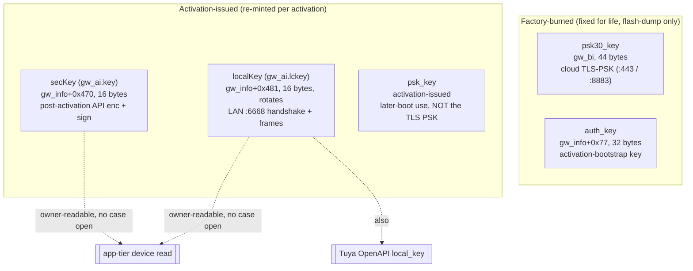
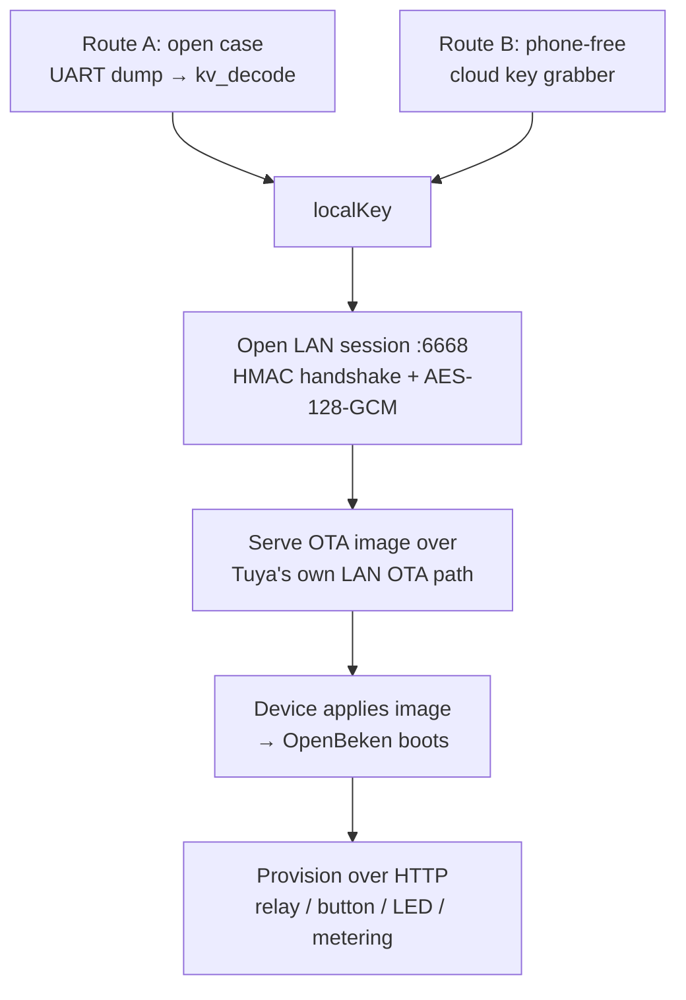

# Architecture

What the device's key material is, how each key gates a different plane, and
the two ways an owner recovers their own keys to reflash. This is the "why it
works" behind [FLASHING.md](FLASHING.md) and [PROVISIONING.md](PROVISIONING.md).

**This page describes the Series 4 (BK7238).** The key model is the same
generation, but the Series 3's cloud record has no `secKey` at all and its
firmware has no LAN OTA receiver, so the chain below does not close on that
product. See [SERIES-3.md](SERIES-3.md).

Framing, up front: this is an owner operating on their own hardware with their
own cloud-issued keys. There's no signature check being broken: the BK7238
bootloader has none. The local-key disclosure the reflash leans on is already
public prior art for this chip family (see
[REFERENCES.md](REFERENCES.md#4-dumbermoretuya--cve-2026-30613)).

## The five credentials

The device holds five distinct credentials, in two groups that behave very
differently. The factory-burned pair is fixed for the device's life and only
comes out of a flash dump. The activation-issued set is re-minted by Tuya's
cloud on each activation, and two of the three are readable by the account
owner without opening the case at all.



| Credential | Where | Provenance | Used for | Owner-readable without opening the case |
|---|---|---|---|---|
| `psk30_key` | `gw_bi`, 44 B | Factory-burned | The cloud TLS-PSK, passed verbatim to the `:443`/`:8883` connections | No, flash dump only |
| `auth_key` | `gw_info+0x77`, 32 B | Factory-burned | Inner-cipher/sign key for exactly one call: the activation bootstrap | No, flash dump only |
| `secKey` (`gw_ai.key`) | `gw_info+0x470`, 16 B | Activation-issued | Post-activation cloud API: body encryption + request HMAC | Yes, app-tier device read |
| `localKey` (`gw_ai.lckey`) | `gw_info+0x481`, 16 B | Activation-issued, rotates | The LAN plane (`:6668`): HMAC-SHA256 handshake, AES-128-GCM frame envelope | Yes, Tuya OpenAPI, and the app-tier read |
| `psk_key` | n/a | Activation-issued | Consumed by later boots; a separate, confusingly-named field, not the TLS PSK | No |

Two rules that matter before trusting any key value:

- **The activation-issued set rotates.** `localKey` (and the `devId` it's
  issued against) is re-minted per activation. Any value in a flash dump is a
  snapshot, not a live credential. Read the device's current keys before
  using them.
- **These are device credentials, not account credentials.** They identify one
  device to Tuya's cloud and give LAN control of that one device. They are not
  a login to the owner's account and don't expose other devices.

## The phone-free key grabber

Normally you'd get `localKey` either by opening the case and dumping flash, or
from the phone app. Neither is necessary: the account owner can read their own
devices' `localKey`/`secKey` headless, by running the vendor's own request
signer offline instead of on a phone.

The one non-obvious piece is the signer. Tuya's app signs every cloud request
with native code (`libthing_security.so`). Rather than reimplement it, the
vendor's own library is executed offline in an emulator: same bytes in, same
signature out, so no phone is in the loop. Everything else is ordinary
owner-authenticated API use.

```mermaid
sequenceDiagram
    actor Op as Owner (headless)
    participant Sig as Vendor signer<br/>(their own lib, emulated)
    participant Cloud as Tuya cloud

    Note over Op,Sig: every request is signed by running the vendor's own code offline
    Op->>Sig: init (derive sign key, verify cert)
    Sig-->>Op: signer ready
    Op->>Cloud: login (owner credentials)
    Cloud-->>Op: session token + ecode
    Op->>Cloud: read home list (body-less)
    Cloud-->>Op: home gid
    Op->>Cloud: read device list (gid)
    Cloud-->>Op: devId, uuid, localKey, secKey per device
    Note over Op,Cloud: yields the activation-issued keys;<br/>the factory-burned pair still needs a flash dump
```

Confirmed live end to end: one login, a body-less home-list read returning the
account's `gid`, then a device-list read returning each device's
`localKey`/`secKey`. It recovers the activation-issued keys only. The
factory-burned `psk30_key`/`auth_key` never leave the flash, so a case-open
dump is still the only route to those.

## The reflash chain

With `localKey` in hand, from either route, the reflash rides Tuya's own LAN
OTA path. The device is told to fetch an OTA image over its local `:6668`
session; the image installs OpenBeken in the app partition. After it boots,
the rest is HTTP, no soldering (see [PROVISIONING.md](PROVISIONING.md)).



The served image and the dumps behind this are in
[`served-images/`](served-images/README.md) and [`dump/`](dump/README.md).
