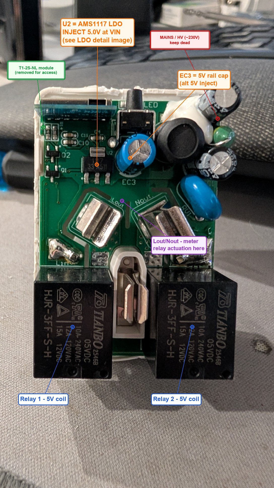
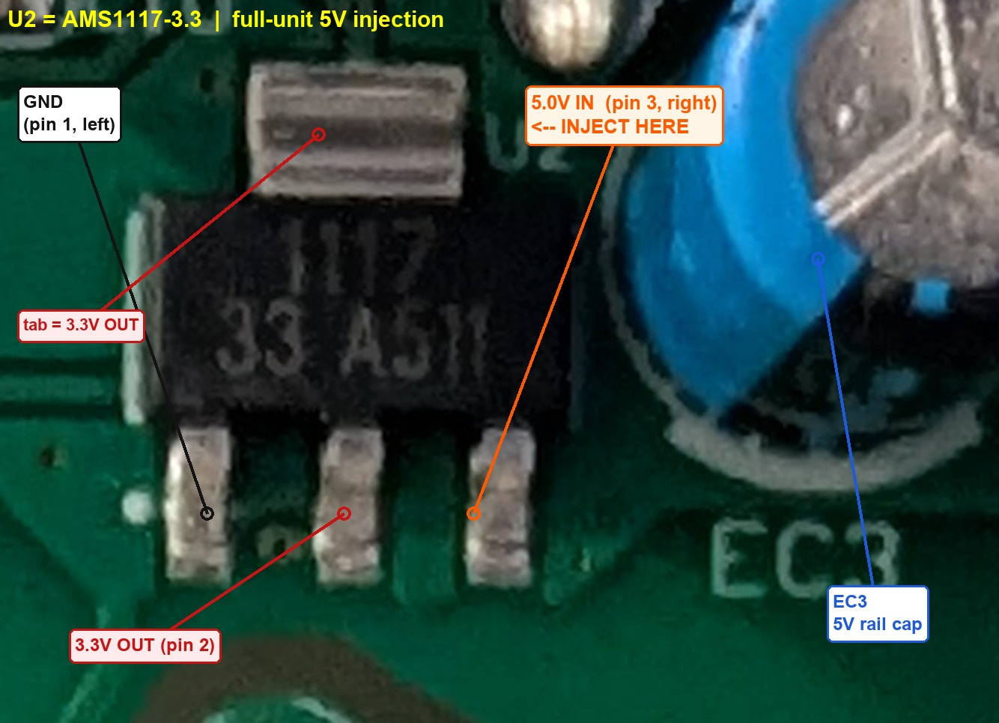

# Flashing: serial, BK7238 (Series 4)

The case-open route: dump the stock firmware, then flash OpenBeken. Needs
`ltchiptool` and a USB-TTL adapter. Read the safety section before you
connect anything. This board's power stage is not isolated from mains.

**This page is the Series 4 (T1-2S-NL / BK7238).** The mains hazard and the
bench-supply discipline apply to any non-isolated plug, but the pads, the
partition map and the image family below are this board's. The Series 3
(CB2S / BK7231N) is a different module with a different bootloader. See
[SERIES-3.md](SERIES-3.md).

## The mains hazard, and how to avoid it entirely

**This board's supply is not isolated.** The rail feeding the module comes
off the mains section through a non-isolated buck converter. There's no
transformer. Everything referenced to that ground is live relative to earth.



That matters the instant a USB-serial adapter's GND touches the module's
GND: the adapter is grounded through your USB host, and the host is grounded
through its own mains lead. Two earth-referenced points meeting a
live-referenced one is how flashing rigs get destroyed, and how people get
hurt.

**So: don't flash with mains connected, and don't power the module from the
board's own supply.** Power it from a bench supply at **3.3 V**, straight
onto the module's `3V3`/`GND` pads, with mains fully disconnected for the
whole session. This also sidesteps a second problem: a USB-serial adapter's
own 3.3 V pin can't supply the current a Wi-Fi SoC wants on inrush, and
"flashing failures" that are actually voltage drops are extremely common on
this class of board. Common all three grounds (bench supply, adapter, module)
to one node, or you get noise or silence instead of a clean UART link.

## Wiring

```
BENCH SUPPLY 3.3V            USB-TTL ADAPTER
+3V3     GND                 GND  TX  RX  3V3
 │        │                   │   │   │   └─ leave disconnected
 │        └────────common ground──┘   │
 │                                    │
reset switch (open=run, close=reset)  │
 │                                    │
MODULE edge pads: 3V3  GND  RX1  TX1  (P9, P24 unused here)
                         │    │    └── crossed to adapter TX
                         │    └─────── crossed to adapter RX
                         └──────────── common ground
```

TX/RX are crossed: the adapter's TX drives the module's `RX1`. Don't power
the module from the adapter's 3.3 V pin. If you see a clean boot banner that
truncates at the same point and repeats on a fixed period, that's brownout,
not a wiring fault.

**Alternative: power the whole board, not just the bare module.** If you want
the relay to audibly click or the BL0942 to read during bring-up, not just a
bare-module serial session, inject 5 V at the AMS1117 LDO's input pin
instead of 3.3 V at the module's pads. The LDO then supplies the module the
same way the board's own (disconnected) mains supply would, and the relay
coils, which run off the 5 V rail directly, come alive too.



### Reset: no CEN pad on this product, so toggle power instead

This module has a `CEN` pin per its datasheet, but it isn't broken out on
this board's accessible pads. Beken's download mode is entered by the chip
talking to the flasher: start the flash tool, then reset *while it's trying
to link*. Without CEN, that reset is cycling the 3.3 V supply: open the
switch (~2s), close it, and let the tool keep retrying. It can take a while
and several cycles. That's normal, not a sign the rig is broken.

If you're scripting this rather than hand-timing it, check your serial
library isn't fighting you: pyserial asserts DTR/RTS on `Serial.open()` by
default, and some flashing tools reopen the port as part of their own reset
sequence, so the power pulse and the tool's link check can end up
overlapping instead of sequenced. Open the port with DTR/RTS both released
if your flashing tool doesn't already do this.

### Should the module come off the board first?

**No, not as a first move.** The module being present on the board isn't
itself the problem; contention on the UART lines would be, if something else
on the board also drives `RX1`/`TX1`. On this board that's the BL0942
metering chip, which shares UART1 with the flashing port. Just try the flash
first. A UART TX idles high, so a powered-but-idle BL0942 holds the line
high, which looks like no signal and doesn't interfere. It only becomes a
problem if the BL0942 transmits while you're trying to flash, and the cheap
fix if that happens is lifting one pin on the BL0942, not desoldering the
Wi-Fi module.

### Soldering

No headers. Wires go to the castellated edge pads directly.

- The traces under the module are fine-pitch and dense. Thin wire, generous
  flux, check for solder bridges with a loupe before applying power. A bridge
  between `3V3` and `GND` is not a mistake you get to make twice.
- Keep signal wires off the antenna (the blue PCB extension next to the
  pads), a wire draped across it detunes it, and that shows up later as a
  weak Wi-Fi link.
- Anchor the wires (tape or hot glue) before moving the board. Castellated
  pad joints pull off the moment a wire snags.

The case is ultrasonically welded; expect cosmetic damage on reassembly, and
make sure reassembly preserves mains isolation. This isn't a snap-it-back
job.

## Procedure

### 1. Dump the stock firmware first

Do this before flashing anything. It's the only backup this unit will ever
have, and it costs nothing extra since it needs the same wiring.

```bash
python tools/bk_resume_read.py <port> dump/stock-full-2MiB.bin
```

Use a resumable, block-checked reader rather than a single long read if one's
available. A dropout mid-dump on a device with a shaky UART link costs one
block instead of the whole attempt.

### 2. Flash OpenBeken

Grab the `QIO` image (not the `.rbl`, which is for OTA, once something is
already running) from the [OpenBeken releases page](https://github.com/openshwprojects/OpenBK7231T_App/releases):

```bash
ltchiptool flash write OpenBK7238_QIO_<version>.bin -d <port>
```

Wrong image family bricks the boot; `ltchiptool` detects the file type, so
let it refuse rather than forcing it.

### 3. First boot, over Wi-Fi from here

Join the device's own `OpenBK7238_<id>` access point and set your Wi-Fi
credentials. Continue in [PROVISIONING.md](PROVISIONING.md): pins, startup
command, and metering all get configured over HTTP from this point, no more
soldering required.

## If it boot-loops

OpenBeken counts boots that don't survive `FullBootTime` (5s). Five
consecutive incomplete boots trips safe mode, which is flash-persisted and
survives a power cycle. A normal power cycle, one that boots fine but can't
join Wi-Fi, is a *successful* boot as far as that counter's concerned, and
resets it to zero; deliberately tripping safe mode needs five short
(~2-3s) power cycles in a row. `cm?cmnd=reboot` is a silent no-op once you're
in safe mode; `GET /index?restart=1` is the one that actually restarts.
Safe mode disables pin/relay execution. It doesn't wipe the saved config.
