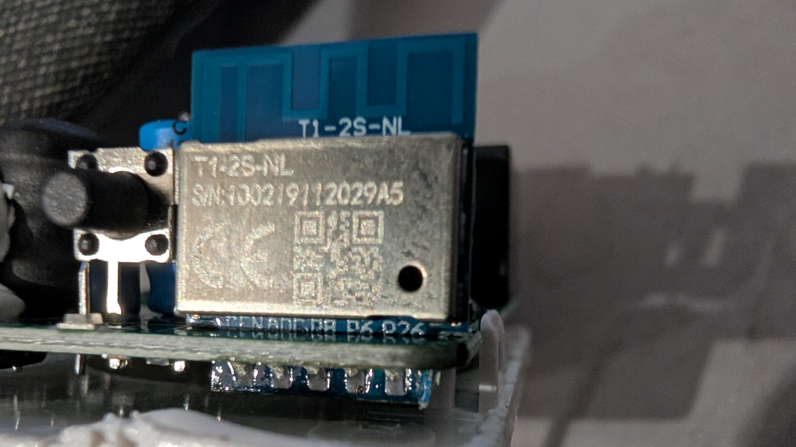
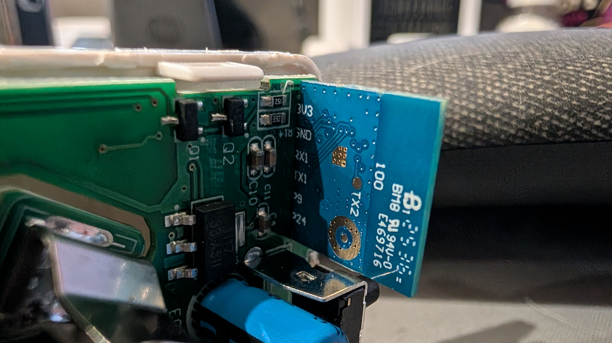
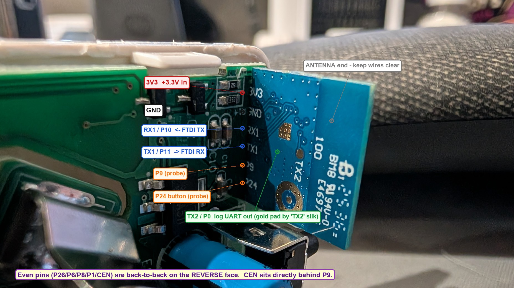

# Hardware: Series 4 (BK7238)

Module identification, flash layout, and this board's confirmed pin roles.
Verified against [LibreTiny's T1-2S board page](https://docs.libretiny.eu/boards/t1-2s/)
and live on real units. See [REFERENCES.md](REFERENCES.md) for the sources.

**This page is the Series 4 only.** The Series 3 is a different module
(CB2S / BK7231N) with a different flash layout and a *permuted* pin map. See
[SERIES-3.md](SERIES-3.md). Nothing here transfers to it.

## Module

**T1-2S-NL**, Tuya's own name for a **Beken BK7238**: Wi-Fi + BLE combo,
2 MiB flash, no flash encryption, 288 KB RAM (datasheet) / 256 KiB (LibreTiny;
the two sources disagree and neither write-up here picks a winner).



Castellated edge pads, no headers:

```
3V3   GND   RX1   TX1   P9   P24
```

`P9` and `P24` are spare pads on this footprint; `P24` is also this board's
button pin (below). There's no `CEN` pad broken out here even though the
module datasheet lists one. The module has it, this product just didn't
route it anywhere reachable.

### UARTs

| | Pins | Role |
|---|---|---|
| UART1 | `RX1`/`TX1` = `P10`/`P11` | Flashing. Also where BL0942 metering talks, so metering only starts once the flashing job is done with it. |
| UART2 | `TX2`/`RX2` = `P0`/`P1` | Boot log. Not broken out on the edge pads, but the `TX2` pad near the antenna is a real, solderable ENIG test point, silkscreened. |

RX/TX are crossed against a plain USB-serial adapter: the adapter's TX drives
the module's `RX1`. A dev-board-as-bridge would be straight-through instead,
because its silkscreen names the chip's own pins, not the adapter's.



## Flash partition map

4096-byte aligned (the raw layout is CRC16-interleaved: 32 data bytes + 2
check bytes, repeated, so real offsets are 32/34 of these; see LibreTiny for
the de-interleaving math if you're reading the dump directly rather than
through a tool that already handles it).

| Partition | Offset | Size |
|---|---|---|
| Bootloader | `0x000000` | 68 KiB |
| App (Tuya firmware) | `0x011000` | 1.1 MiB |
| OTA download | `0x12C000` | 724 KiB |
| OTA info | `0x1E1000` | 4 KiB |
| Calibration (RF) | `0x1E3000` | 4 KiB |
| LibreTiny storage | `0x1E4000` | 32 KiB |
| User data | `0x1EC000` | 80 KiB |
| **Tuya storage (KV store)** | **`0x1F5000`** | **44 KiB** |

The Tuya storage block is the one that matters for reflashing: it's an
AES-ECB-encrypted key/value store holding the device's pin map and its
cloud-issued keys (`uuid`, `auth_key`, PSK). The encryption uses a static key
shared across the firmware family, not a per-device secret. Decoding it is
how you get your own device's keys back out, and it's the same mechanism
[a published CVE on a different product using this exact module](REFERENCES.md#4-dumbermoretuya--cve-2026-30613)
already documents independently of this project. `tools/kv_decode.py`
decodes it; it needs a real dump, not guessing. The pin names in the
firmware's own string table are a format-string schema (`"rl1_pin: %d"`),
not the values.

## This board's pin roles (Series 4, confirmed live)



| Pin | OpenBeken role | Channel | Note |
|---|---|---|---|
| `P26` | `Rel` (1) | 1 | active-high relay |
| `P24` | `Btn` (3) | 1 | active-low button |
| `P8` | `LED` (5) | 1 | relay indicator, **not** `WifiLED` (role 8); this board sets `netled_reuse:1`, so the LED follows the relay, not Wi-Fi state |
| `P10`/`P11` | n/a | n/a | UART1, BL0942 metering at 4800 8N1, started by `startDriver BL0942` |

**Channel numbering is a trap if you're porting a config from a related
product.** This board uses channel 1 for relay/button/LED; some siblings in
the same family use channel 0. Copying a config across silently binds the
relay to nothing.

Both relays on this board are driven together: active and neutral switched
as one safety unit, not two independent sockets.
