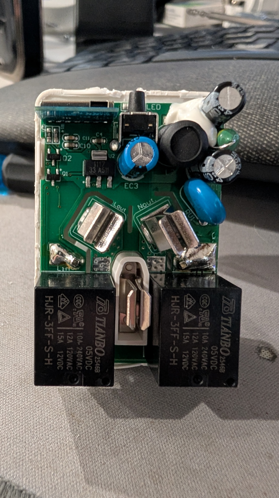

# tuya-s4-research

Reflashing an Arlec PC191HA Series 4 smart plug — stock Tuya firmware to
[OpenBeken](https://github.com/openshwprojects/OpenBK7231T_App) — using the
owner's own hardware and their own cloud-issued keys. Not a vulnerability.
This bootloader has no signature check to bypass; the "attack" is reading a
dump, decoding Tuya's own on-device key store, and using those keys the way
Tuya's own OTA path would.

**Read the safety section in [FLASHING.md](FLASHING.md) before connecting
anything.** This board's power stage is not isolated from mains. Get that
wrong and you can damage more than the plug.

## Hardware

| | |
|---|---|
| Product | Arlec PC191HA, Series 4 |
| Module | T1-2S-NL (Beken BK7238), 2 MiB flash, no flash encryption |
| Relay | 2× `TIANBO HJR-3FF-S-H`, 10 A 240 VAC, switching active + neutral together |
| Metering | BL0942, UART1 (shared with the flashing port) |

Same module family as a handful of other Tuya/Beken products — see
[REFERENCES.md](REFERENCES.md) for independent teardowns of the same silicon
in different products, including one with a published CVE for the same class
of local key disclosure this project relies on.

## What's here

- [ARCHITECTURE.md](ARCHITECTURE.md) — the device's key material, what each
  key gates, and the two ways an owner recovers their own keys to reflash.
  The "why it works" behind the how-to docs.
- [HARDWARE.md](HARDWARE.md) — module pinout, flash partition map, this
  board's confirmed pin roles.
- [FLASHING.md](FLASHING.md) — dumping stock firmware and flashing OpenBeken
  over serial, safely.
- [PROVISIONING.md](PROVISIONING.md) — getting from "OpenBeken boots" to
  "relay, button, LED and metering all configured and verified."
- `tools/` — the scripts referenced from the docs above.
- `images/` — board and module photos referenced from the docs above.
- [`dump/`](dump/README.md) — full flash reads: stock, post-OpenBeken, and the
  app partition pre-extracted for a disassembler.
- [`served-images/`](served-images/README.md) — the actual OTA images pushed
  to real hardware to install OpenBeken.

## Scope

This covers one product family on one chip. It's not a general Tuya-cracking
toolkit, and the key-recovery step (decoding the on-device KV store) is
specific to this hardware generation — don't assume it carries over to a
different Tuya module without checking.

## License

[CC BY-NC 4.0](LICENSE) — attribution required, no commercial use.
