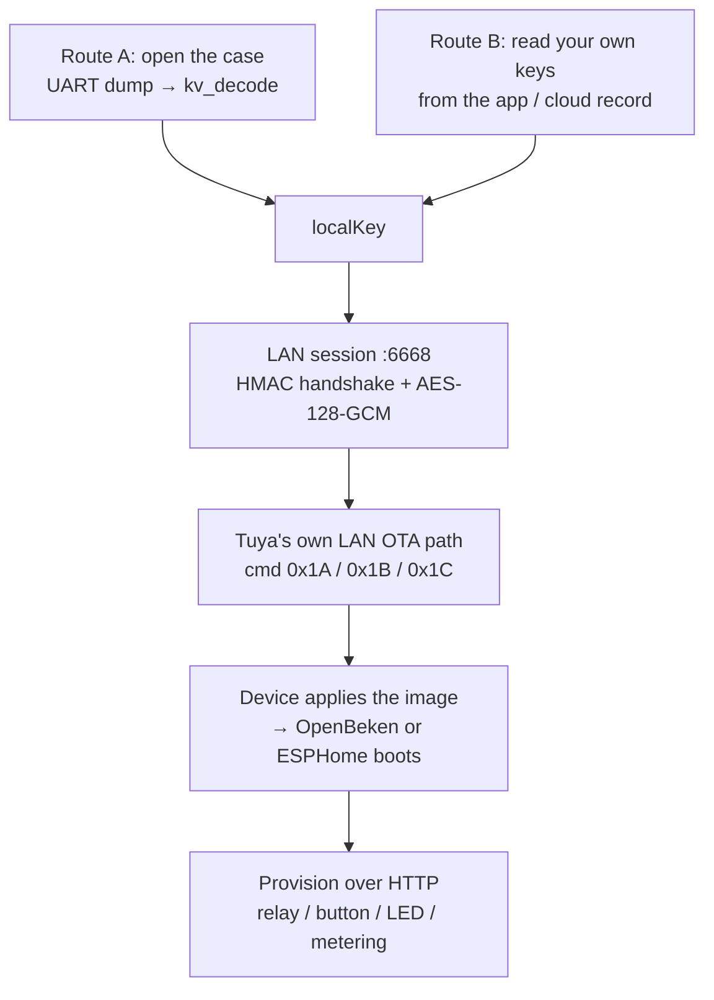

# Series 4: status

The reflashable one. Arlec PC191HA Series 4, module **T1-2S-NL** (Beken
**BK7238**), stock TuyaOS V3 firmware `1.0.2`.

**Status: solved, and reproduced on separate units.** These plugs can be
reflashed to owner firmware over the air, with no case opened and no UART,
using the owner's own Tuya cloud credentials. The same chain also carries
ESPHome. This is not a vulnerability: the bootloader has no signature check
to bypass, and the keys are the account holder's own.

## Hardware

| | |
|---|---|
| Product | Arlec PC191HA, Series 4 |
| Module | T1-2S-NL (Beken BK7238), 2 MiB flash, no flash encryption |
| Relay | 2× `TIANBO HJR-3FF-S-H`, 10 A 240 VAC, switching active + neutral together |
| Metering | BL0942, UART1 (shared with the flashing port) |
| Pins | `P26` relay ch 1 active-high · `P24` button ch 1 active-low · `P8` relay-indicator LED ch 1 · `P10`/`P11` UART1 |

Full detail: [HARDWARE.md](HARDWARE.md).

## The two routes

**Route A: serial.** Open the case, dump the stock firmware, flash over UART.
Fully proven; it is how every dump in [`dump/`](dump/README.md) was taken, and
it is the only route that needs no cloud credential. Procedure and the mains
safety rules: [FLASHING.md](FLASHING.md).

**Route B: LAN OTA, no case open.** The device is told to fetch an image over
its own local `:6668` session, and installs it into the app partition. This is
Tuya's own update path, driven with the owner's own keys. The key model and
why it works: [ARCHITECTURE.md](ARCHITECTURE.md).

## What is proven

| Claim | Evidence |
|---|---|
| The bootloader accepts an owner-built image on CRC32 alone | Live: an owner-built image was written over the air and the bootloader jumped to it unconditionally |
| The LAN handshake completes with the cloud-issued `localKey` | Live, on hardware |
| The OTA-start gate accepts an owner-supplied container | Live; the container's `bin_type` must be one of four accepted words (`ISBA`/`8RBA`/`QCZL`/`RCZL`) |
| The chunk transfer runs to completion | Live; full transfers of both a no-op and a real OpenBeken container |
| The completion check is satisfiable by computing it | Live, device-confirmed: `fileHmac = HMAC-SHA256(secKey, uppercase-hex(SHA256(served file)))` |
| The result boots and is usable | Live: relay, relay indicator, and BL0942 metering all come up and survive a real power cycle |
| It reproduces | **Three separate units** reflashed with no case opened: two to OpenBeken, one from stock to ESPHome with the whole transfer captured on the wire |

The `secKey` that signs the completion check is the one input the Tuya OpenAPI
does not serve. It has to come from the app's own device record or the
activation reply. That is the biggest usability cliff in the chain, and it is
why the published tooling takes it as an argument rather than fetching it.

## ESPHome as a second target

The same container format carries ESPHome, built through LibreTiny's `bk72xx`
component with `board: t1-2s`. It needs **ESPHome ≥ 2026.5.0**, the
first release with the BK7238 family and the `t1-2s` board at all.

Two build-output traps worth knowing before you try it:

- `firmware.bin` is **not** the app: it is a UF2 package despite the name.
- `image_bk7238_app.ota.ug.bin` is LibreTiny's own OTA container. It has the
  same diff2ya header magic but `bin_type` `PCZL`, which this device's applier
  does not accept. The tag has to be `RCZL`.

The file you want is `raw_firmware.bin`, the bare app straight off the linker.
Wrap it in the same `RCZL` container and it goes over the same LAN path.

Unlike OpenBeken, ESPHome bakes the pin map into the image, so there is no
post-flash provisioning step. `name_add_mac_suffix: true` reads the chip's real
MAC at runtime, so one image serves every unit without the per-unit identity
patch OpenBeken needs.

## Two failure modes, and they are different

Neither is remotely recoverable. Both need UART.

| Mode | What it looks like | Cause |
|---|---|---|
| **Bricked** | No ARP, no ICMP, not on the network at all | A **truncated transfer**. Closing the pipe mid-transfer is enough. |
| **Wedged** | Ping and MQTT keepalives fine; DP engine, button and LAN plane dead; `:6668` answers RST | A **completed** apply that leaves the application's post-boot transition unfinished |

A completed transfer is **not** a successful flash. Any wrapper around this
chain has to verify by probing a management surface afterwards, and has to
accept either the stock surface set (TCP `:6668` + UDP `7000`) or OpenBeken's
HTTP `:80` serving `/api/info`; checking the stock ports alone scores every
successful OpenBeken flash as wedged.

## What is not proven

- **The wedge's root cause.** A byte-identical image has both applied cleanly
  and wedged a unit. The mechanism is characterised, not explained.
- **An over-the-air flash *read*.** There is none. You cannot back a unit up
  without opening it, which is why Route A is still the only way to keep a
  stock image.
- **Metering calibration.** The BL0942 comes up uncalibrated; calibration is a
  per-unit step against a known resistive load.
- **Metering on every unit.** It is confirmed live on several, not audited on
  all of them.

## Where to go next

- [ARCHITECTURE.md](ARCHITECTURE.md): the key model, and why the keys are the
  owner's to use.
- [FLASHING.md](FLASHING.md): the serial route, and the mains safety rules.
- [PROVISIONING.md](PROVISIONING.md): relay, button, LED and metering after
  the flash.
- [`served-images/`](served-images/README.md): the containers actually pushed
  to hardware.
